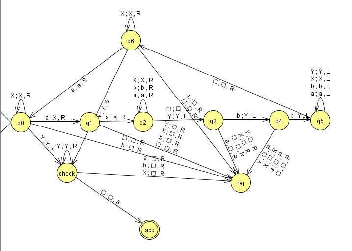
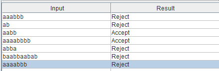
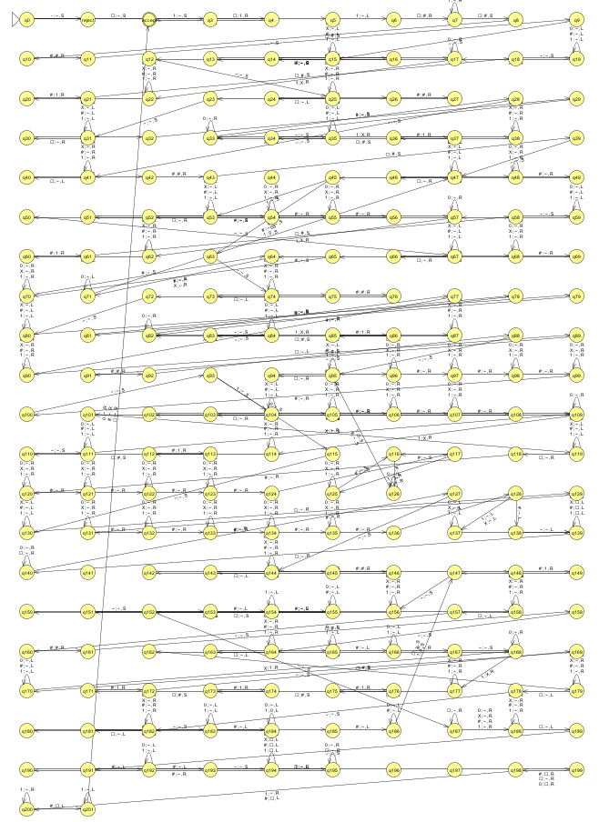

# Практичсекая работа №6. Машины Тьюринга
## Цель работы
Исследование свойств универсальных вычислительных машин на примере абстрактной машины Тьюринга.

## Вариант задания
**Вариант 15.**  
Первая МТ предназначена для распознавания языка $L = \{a2nb2n : n > 0\}$. Вторая МТ предназначена для вычисления функции $f(x) = 3$^$x$^$3$, где ^ – это операция возведения в степень.

## Первая МТ

## Перехваты экранов распознования тестовых цепочек

## Вторая МТ

## Перехваты экранов распознования тестовых цепочек

